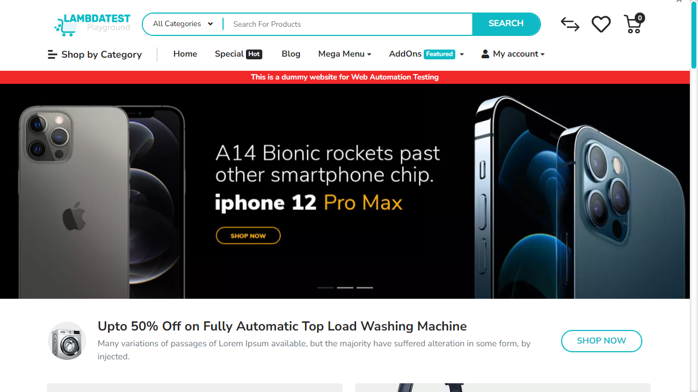
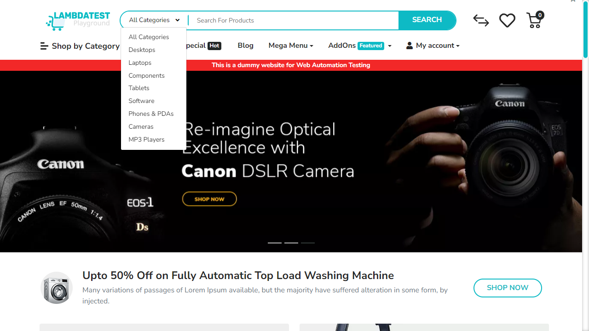
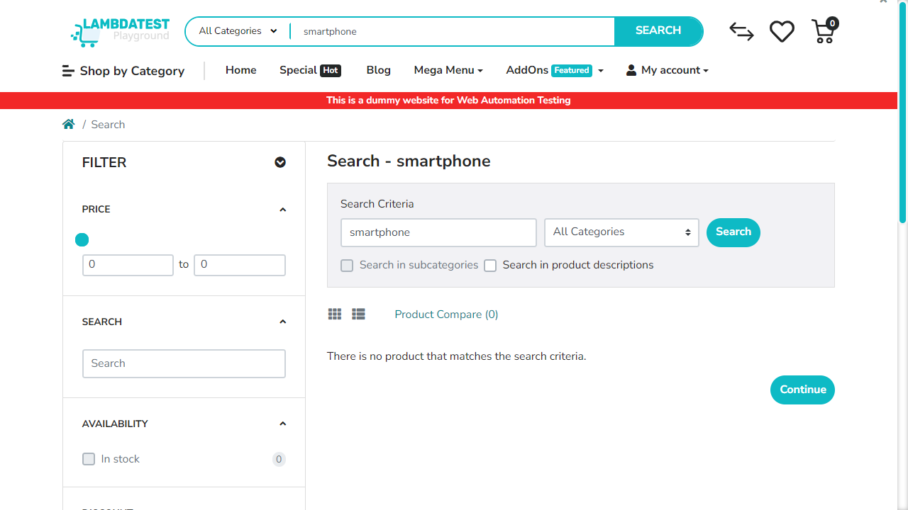

# 📑 Auto-Generated Site Documentation Report

This site documentation report was automatically generated during an AI-powered exploratory crawl.

- **Crawl Target**: [https://ecommerce-playground.lambdatest.io/](https://ecommerce-playground.lambdatest.io/)
- **Timestamp**: 28/05/2026, 19:31:55
- **Run ID**: `run-1779985831128`
- **AI Ollama Model**: `qwen2.5-coder:7b`

---

## 🗺️ Sitemap
The following unique paths and pages were discovered during the exploratory run:

| Path | Page Title |
| --- | --- |
| `/` | Your Store |
| `/index.php` | Search - smartphone |

---

## 🔍 Locator Registry
The table below logs pre-identified CSS selectors for forms, input elements, text fields, and action buttons found on each unique page path:

### Path: `/`

| Element Type | Name / Text | Placeholder | Stable CSS Selector |
| --- | --- | --- | --- |
| `text` | `search` | `Search For Products` | `[name="search"]` |
| `button` | `Edit cart` | _N/A_ | `button.icon-right` |
| `button` | _N/A_ | _N/A_ | `button.icon-left` |
| `button` | `All Categories` | _N/A_ | `button.btn` |
| `button` | `Search` | _N/A_ | `button.type-text` |
| `button` | `0   0 item(s) - $0.00` | _N/A_ | `button.cart` |

### Path: `/index.php`

| Element Type | Name / Text | Placeholder | Stable CSS Selector |
| --- | --- | --- | --- |
| `number` | `mz_fp[min]` | `Minimum Price` | `[name="mz_fp[min]"]` |
| `number` | `mz_fp[max]` | `Maximum Price` | `[name="mz_fp[max]"]` |
| `text` | `mz_fq` | `Search` | `[name="mz_fq"]` |
| `checkbox` | `mz_fss` | _N/A_ | `#mz-fss-1--1` |
| `radio` | `mz_fd` | _N/A_ | `#mz-fd-1-10` |
| `radio` | `mz_fd` | _N/A_ | `#mz-fd-1-20` |
| `radio` | `mz_fd` | _N/A_ | `#mz-fd-1-30` |
| `radio` | `mz_fd` | _N/A_ | `#mz-fd-1-40` |
| `radio` | `mz_fd` | _N/A_ | `#mz-fd-1-50` |
| `radio` | `mz_fr` | _N/A_ | `#mz-fr-1-4` |
| `button` | `Edit cart` | _N/A_ | `button.icon-right` |
| `button` | _N/A_ | _N/A_ | `button.icon-left` |
| `button` | `All Categories` | _N/A_ | `button.btn` |
| `button` | `Search` | _N/A_ | `button.type-text` |
| `button` | `0   0 item(s) - $0.00` | _N/A_ | `button.cart` |

---

## 🛣️ User Journey Summary
This log traces the navigation and action sequence executed by the AI crawler, including screenshots captured at each step:

### Browser: **EDGE**

#### Step 1: Navigate to https://ecommerce-playground.lambdatest.io/
- **From Path**: `Start`
- **To Path**: `/`
- **AI Rationale**: _Initial page load_

---

#### Step 2: [R1] screenshot
- **From Path**: `/`
- **To Path**: `/`
- **AI Rationale**: _Capture initial state_

---

#### Step 3: [R1] click → button.btn
- **From Path**: `/`
- **To Path**: `/`
- **AI Rationale**: _Navigate to All Categories page_

---

#### Step 4: [R1] wait
- **From Path**: `/`
- **To Path**: `/`
- **AI Rationale**: _Wait for page to load_

---

#### Step 5: [R1] scroll → body
- **From Path**: `/`
- **To Path**: `/`
- **AI Rationale**: _Scroll to bottom of page_

---

#### Step 6: [R2] click → [name="search"]
- **From Path**: `/`
- **To Path**: `/`
- **AI Rationale**: _Identify search input field_

---

#### Step 7: [R2] fill → [name="search"]
- **From Path**: `/`
- **To Path**: `/`
- **AI Rationale**: _Type a search term in the input field_

---

#### Step 8: [R2] click → [type="text"][aria-label="Search"]
- **From Path**: `/`
- **To Path**: `/index.php`
- **AI Rationale**: _Trigger the search action_

---

#### Step 9: [R2] wait
- **From Path**: `/index.php`
- **To Path**: `/index.php`
- **AI Rationale**: _Wait for the search results to load_

---

#### Step 10: [R2] screenshot
- **From Path**: `/index.php`
- **To Path**: `/index.php`
- **AI Rationale**: _Capture the search results page_

---

