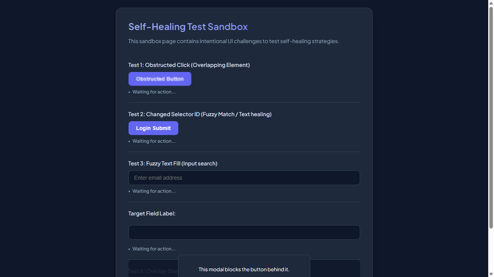
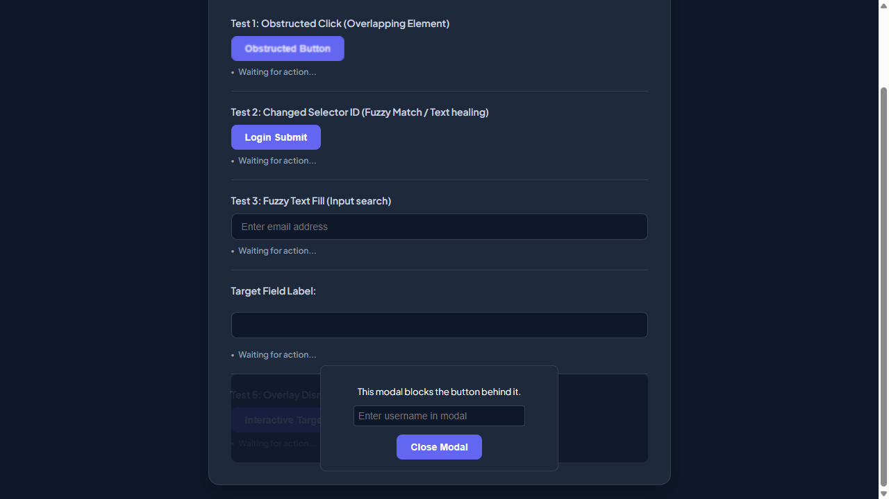
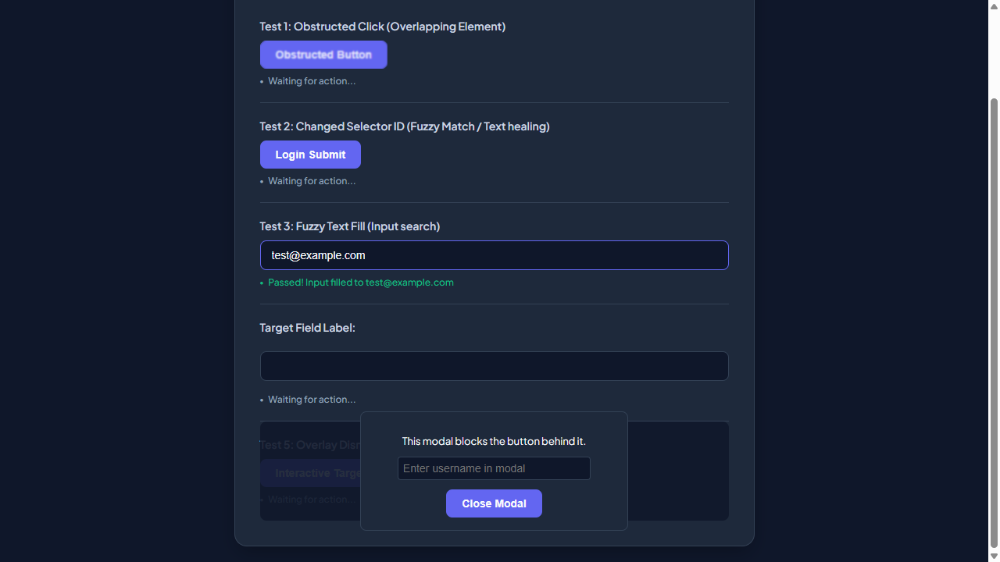
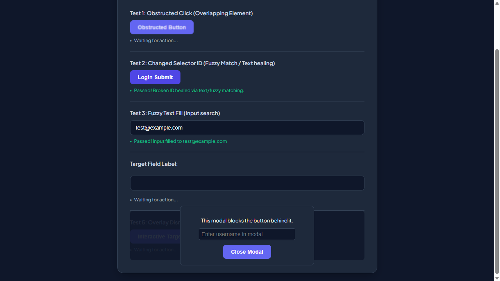

# 📑 Auto-Generated Site Documentation Report

This site documentation report was automatically generated during an AI-powered exploratory crawl.

- **Crawl Target**: [http://localhost:3009/test-self-healing.html](http://localhost:3009/test-self-healing.html)
- **Timestamp**: 28/05/2026, 20:00:12
- **Run ID**: `run-1779987424131`
- **AI Ollama Model**: `qwen2.5-coder:7b`

---

## 🗺️ Sitemap
The following unique paths and pages were discovered during the exploratory run:

| Path | Page Title | Headings Detected |
| --- | --- | --- |
| `/test-self-healing.html` | Self-Healing Test Sandbox | H1: Self-Healing Test Sandbox |

---

## 🔍 Locator Registry
The table below logs pre-identified CSS selectors for forms, input elements, text fields, and action buttons found on each unique page path:

### Path: `/test-self-healing.html`

| Element Type | Name / Text | Placeholder | Stable CSS Selector |
| --- | --- | --- | --- |
| `text` | _N/A_ | `Enter email address` | `#user-email-address` |
| `text` | _N/A_ | _N/A_ | `input[type="text"]` |
| `text` | _N/A_ | `Enter username in modal` | `#covered-input` |
| `button` | `Obstructed Button` | _N/A_ | `#obstructed-btn` |
| `button` | `Login Submit` | _N/A_ | `#healed-login-submit` |
| `button` | `Interactive Target Button` | _N/A_ | `#covered-btn` |
| `button` | `Close Modal` | _N/A_ | `button.modal-close-button` |

---

## 🛣️ User Journey Summary
This log traces the navigation and action sequence executed by the AI crawler, including screenshots captured at each step:

### Browser: **CHROME**

#### Step 1: Navigate to http://localhost:3009/test-self-healing.html
- **From Path**: `Start`
- **To Path**: `/test-self-healing.html`
- **AI Rationale**: _Initial page load_

---

#### Step 2: [R1] screenshot
- **From Path**: `/test-self-healing.html`
- **To Path**: `/test-self-healing.html`
- **AI Rationale**: _Capture initial state_

---

#### Step 3: [R1] click → #covered-btn
- **From Path**: `/test-self-healing.html`
- **To Path**: `/test-self-healing.html`
- **AI Rationale**: _Identify interactive target button_

---

#### Step 4: [R1] fill → #user-email-address
- **From Path**: `/test-self-healing.html`
- **To Path**: `/test-self-healing.html`
- **AI Rationale**: _Fill email input_

---

#### Step 5: [R1] click → #healed-login-submit
- **From Path**: `/test-self-healing.html`
- **To Path**: `/test-self-healing.html`
- **AI Rationale**: _Submit the login form_

---

#### Step 6: [R1] wait
- **From Path**: `/test-self-healing.html`
- **To Path**: `/test-self-healing.html`
- **AI Rationale**: _Wait for page to respond_

---

#### Step 7: [R2] screenshot
- **From Path**: `/test-self-healing.html`
- **To Path**: `/test-self-healing.html`
- **AI Rationale**: _Capture initial state_

---

