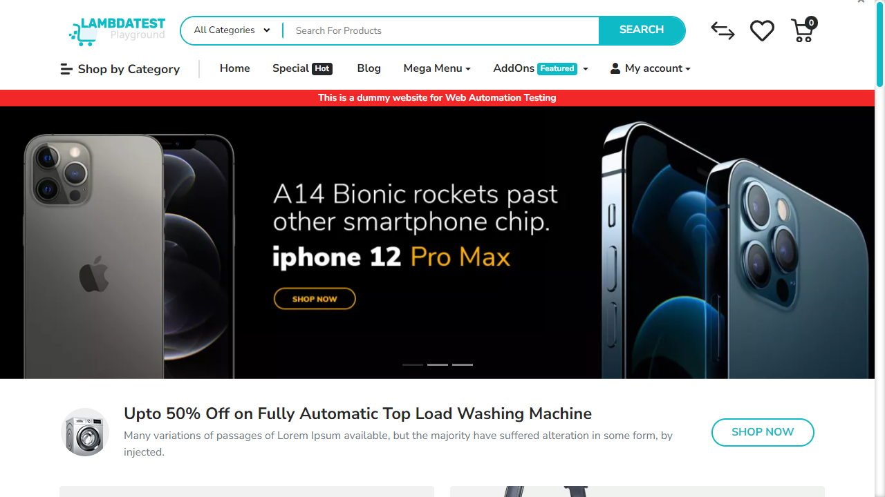
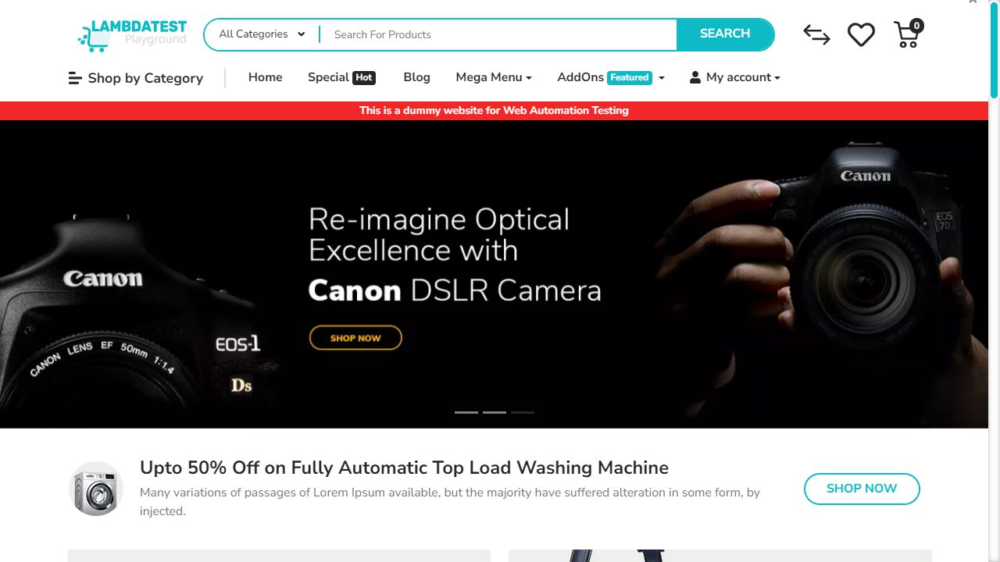
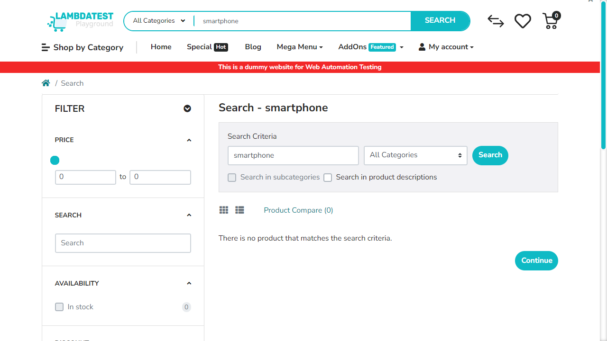
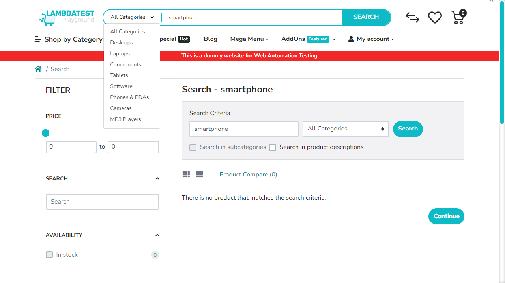

# 📑 Auto-Generated Site Documentation Report

This site documentation report was automatically generated during an AI-powered exploratory crawl.

- **Crawl Target**: [https://ecommerce-playground.lambdatest.io/](https://ecommerce-playground.lambdatest.io/)
- **Timestamp**: 28/05/2026, 20:04:28
- **Run ID**: `run-1779987718022`
- **AI Ollama Model**: `qwen2.5-coder:7b`

---

## 🗺️ Sitemap
The following unique paths and pages were discovered during the exploratory run:

| Path | Page Title | Headings Detected |
| --- | --- | --- |
| `/` | Your Store | H3: Mobiles H3: Laptops H3: Accessories H3: Smart Wearable H3: Tablets H3: Computers H3: Sound System H3: Top Trending Categories H3: Top Products H2: Latest Range of Earphones H3: Top Collection H3: Under @99 H3: From The Blog |
| `/index.php` | Search - smartphone | H3: Mobiles H3: Laptops H3: Accessories H3: Smart Wearable H3: Tablets H3: Computers H3: Sound System H1: Search - smartphone H3: Filter |

---

## 🔍 Locator Registry
The table below logs pre-identified CSS selectors for forms, input elements, text fields, and action buttons found on each unique page path:

### Path: `/`

| Element Type | Name / Text | Placeholder | Stable CSS Selector |
| --- | --- | --- | --- |
| `text` | `search` | `Search For Products` | `[name="search"]` |
| `button` | `Edit cart` | _N/A_ | `button.icon-right` |
| `button` | _N/A_ | _N/A_ | `button.icon-left` |
| `button` | `All Categories` | _N/A_ | `button.btn` |
| `button` | `Search` | _N/A_ | `button.type-text` |
| `button` | `0   0 item(s) - $0.00` | _N/A_ | `button.cart` |

### Path: `/index.php`

| Element Type | Name / Text | Placeholder | Stable CSS Selector |
| --- | --- | --- | --- |
| `number` | `mz_fp[min]` | `Minimum Price` | `[name="mz_fp[min]"]` |
| `number` | `mz_fp[max]` | `Maximum Price` | `[name="mz_fp[max]"]` |
| `text` | `mz_fq` | `Search` | `[name="mz_fq"]` |
| `checkbox` | `mz_fss` | _N/A_ | `#mz-fss-1--1` |
| `radio` | `mz_fd` | _N/A_ | `#mz-fd-1-10` |
| `radio` | `mz_fd` | _N/A_ | `#mz-fd-1-20` |
| `radio` | `mz_fd` | _N/A_ | `#mz-fd-1-30` |
| `radio` | `mz_fd` | _N/A_ | `#mz-fd-1-40` |
| `radio` | `mz_fd` | _N/A_ | `#mz-fd-1-50` |
| `radio` | `mz_fr` | _N/A_ | `#mz-fr-1-4` |
| `button` | `Edit cart` | _N/A_ | `button.icon-right` |
| `button` | _N/A_ | _N/A_ | `button.icon-left` |
| `button` | `All Categories` | _N/A_ | `button.btn` |
| `button` | `Search` | _N/A_ | `button.type-text` |
| `button` | `0   0 item(s) - $0.00` | _N/A_ | `button.cart` |

---

## 🛣️ User Journey Summary
This log traces the navigation and action sequence executed by the AI crawler, including screenshots captured at each step:

### Browser: **CHROME**

#### Step 1: Navigate to https://ecommerce-playground.lambdatest.io/
- **From Path**: `Start`
- **To Path**: `/`
- **AI Rationale**: _Initial page load_

---

#### Step 2: [R1] click → [name='search']
- **From Path**: `/`
- **To Path**: `/`
- **AI Rationale**: _Identify search input_

---

#### Step 3: [R1] fill → [name='search']
- **From Path**: `/`
- **To Path**: `/`
- **AI Rationale**: _Enter search query_

---

#### Step 4: [R1] click → button.type-text
- **From Path**: `/`
- **To Path**: `/index.php`
- **AI Rationale**: _Trigger search action_

---

#### Step 5: [R1] wait
- **From Path**: `/index.php`
- **To Path**: `/index.php`
- **AI Rationale**: _Wait for search results to load_

---

#### Step 6: [R1] screenshot
- **From Path**: `/index.php`
- **To Path**: `/index.php`
- **AI Rationale**: _Capture search results_

---

#### Step 7: [R2] click → [aria-label='All Categories']
- **From Path**: `/index.php`
- **To Path**: `/index.php`
- **AI Rationale**: _Explore all categories_

---

#### Step 8: [R2] screenshot
- **From Path**: `/index.php`
- **To Path**: `/index.php`
- **AI Rationale**: _Capture categories page state_

---

#### Step 9: [R3] click → button.btn
- **From Path**: `/index.php`
- **To Path**: `/index.php`
- **AI Rationale**: _Navigate to All Categories page_

---

#### Step 10: [R3] wait
- **From Path**: `/index.php`
- **To Path**: `/index.php`
- **AI Rationale**: _Wait for page to load_

---

#### Step 11: [R3] screenshot
- **From Path**: `/index.php`
- **To Path**: `/index.php`
- **AI Rationale**: _Capture All Categories page state_

---

#### Step 12: [R3] click → a.icon-left:contains('Mobiles')
- **From Path**: `/index.php`
- **To Path**: `/index.php`
- **AI Rationale**: _Navigate to Mobiles section_

---

#### Step 13: [R3] wait
- **From Path**: `/index.php`
- **To Path**: `/index.php`
- **AI Rationale**: _Wait for page to load_

---

#### Step 14: [R4] click → button.btn[type='submit']
- **From Path**: `/index.php`
- **To Path**: `/index.php`
- **AI Rationale**: _Navigate to All Categories page_

---

#### Step 15: [R5] click → button.btn[type='submit']
- **From Path**: `/index.php`
- **To Path**: `/index.php`
- **AI Rationale**: _Submit search query_

---

#### Step 16: [R5] wait
- **From Path**: `/index.php`
- **To Path**: `/index.php`
- **AI Rationale**: _Wait for results to load_

---

#### Step 17: [R5] screenshot
- **From Path**: `/index.php`
- **To Path**: `/index.php`
- **AI Rationale**: _Capture search results page_

---

