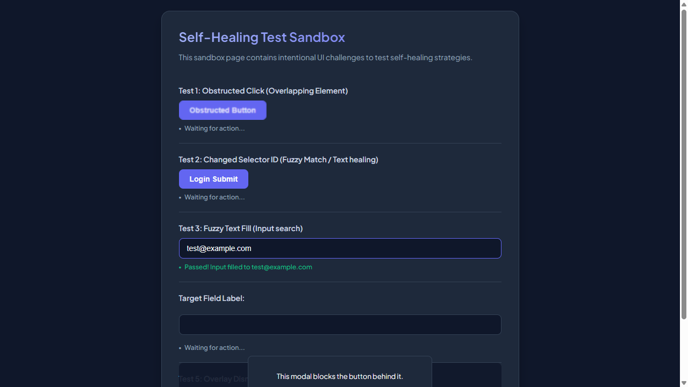
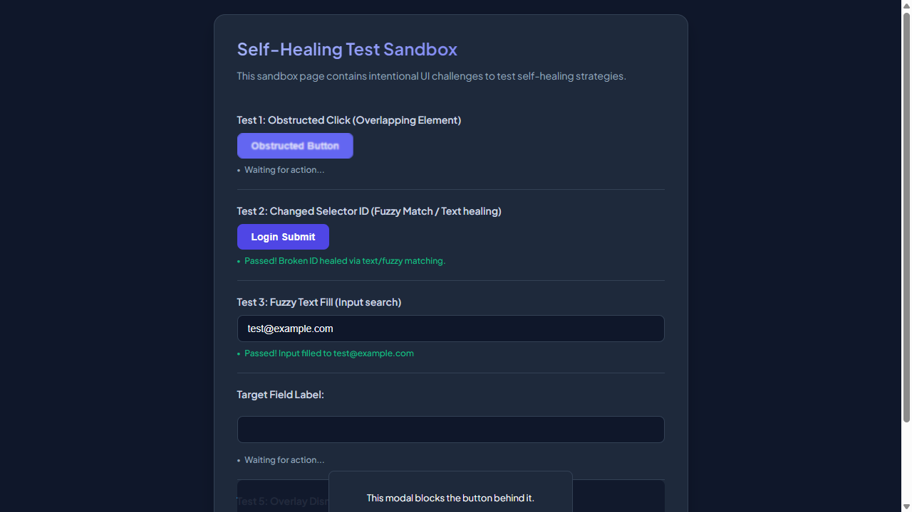
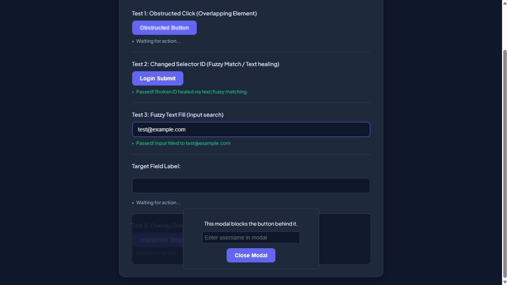
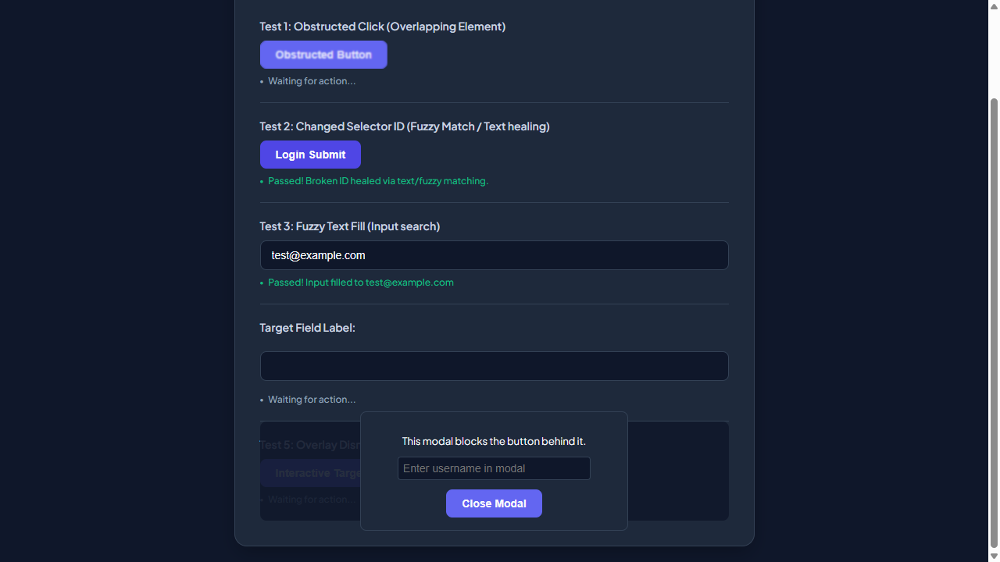
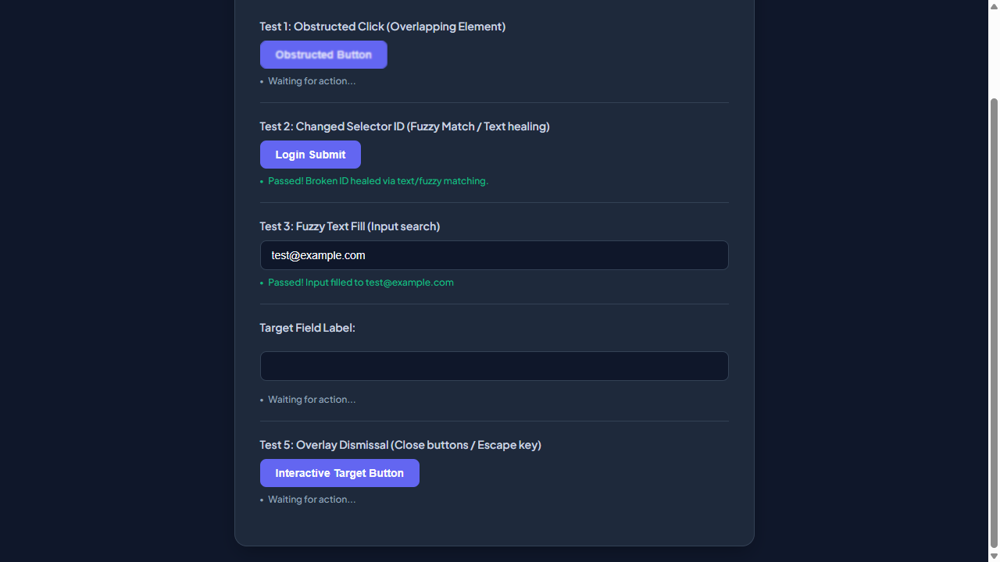
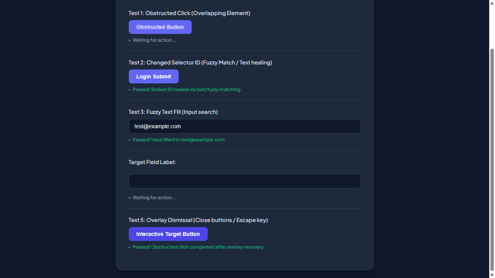

# 📑 WEBSITE BUSINESS SPECIFICATION & FUNCTIONAL INVENTORY
  
This document was automatically generated during an AI-powered business functional crawl.

- **Target Website**: [http://localhost:3009/test-self-healing.html](http://localhost:3009/test-self-healing.html)
- **Crawl Mode**: `Business Auto-Doc Mode (High-Level Summary)`
- **Crawl Date/Time**: 29/05/2026, 00:05:11
- **AI Explorer Model**: `qwen2.5-coder:7b` (Ollama)
- **Browser Executed**: `Chrome (Headless)`

---

## 🗺️ Section 1: Site Sitemap
Below is the list of unique page routes mapped by the AI crawler.

| No. | Page Title | Visited URL Pathname | Heading Hierarchy Detected |
| --- | --- | --- | --- |
| 1. | **Self-Healing Test Sandbox** | `/test-self-healing.html` | H1: "Self-Healing Test Sandbox" |

---

## 🔍 Section 2: Business Feature Catalog (Functional Inventory)
A comprehensive catalog of major UI elements, components, and sections discovered on each page, written in plain business English.

| Page Name | Feature/Component | Functional Description | Business / User Value |
| --- | --- | --- | --- |
| **/test-self-healing.html** | Enter email address | Allows user interaction with the text element. | Improves page engagement and usability. |
| **/test-self-healing.html** | Interactive Element | Allows user interaction with the text element. | Improves page engagement and usability. |
| **/test-self-healing.html** | Enter username in modal | Allows user interaction with the text element. | Improves page engagement and usability. |
| **/test-self-healing.html** | Obstructed Button | Allows user interaction with the button element. | Improves page engagement and usability. |
| **/test-self-healing.html** | Login Submit | Allows user interaction with the button element. | Improves page engagement and usability. |
| **/test-self-healing.html** | Interactive Target Button | Allows user interaction with the button element. | Improves page engagement and usability. |
| **/test-self-healing.html** | Close Modal | Allows user interaction with the button element. | Improves page engagement and usability. |

---

## 🛣️ Section 3: User Journey & Visual Walkthrough
A sequential timeline showing exactly how the AI traversed the site, with explanations and visual proofs.

### Browser Run: **CHROME**

#### Step 1: Navigate to http://localhost:3009/test-self-healing.html

**Functional Intent**: *"Initial page load"*

- **From Path**: `Start`
- **To Path**: `/test-self-healing.html`

**Visual Proof**:

---

#### Step 2: [R1] screenshot

**Functional Intent**: *"Verify page layout and interface elements."*

- **From Path**: `/test-self-healing.html`
- **To Path**: `/test-self-healing.html`

**Visual Proof**:

---

#### Step 3: [R1] fill → #user-email-address

**Functional Intent**: *"Provide user email for login."*

- **From Path**: `/test-self-healing.html`
- **To Path**: `/test-self-healing.html`

**Visual Proof**:

---

#### Step 4: [R1] click → #healed-login-submit

**Functional Intent**: *"Submit the login form to proceed."*

- **From Path**: `/test-self-healing.html`
- **To Path**: `/test-self-healing.html`

**Visual Proof**:

---

#### Step 5: [R2] scroll → #covered-input

**Functional Intent**: *"Ensure all elements are visible for visual verification"*

- **From Path**: `/test-self-healing.html`
- **To Path**: `/test-self-healing.html`

**Visual Proof**:

---

#### Step 6: [R2] click → #covered-btn

**Functional Intent**: *"Interact with an interactive element to demonstrate functionality"*

- **From Path**: `/test-self-healing.html`
- **To Path**: `/test-self-healing.html`

**Visual Proof**:

---

#### Step 7: [R2] fill → #user-email-address

**Functional Intent**: *"Input user email for testing purposes"*

- **From Path**: `/test-self-healing.html`
- **To Path**: `/test-self-healing.html`

**Visual Proof**:

---

#### Step 8: [R2] click → #healed-login-submit

**Functional Intent**: *"Submit the login form to verify submission process"*

- **From Path**: `/test-self-healing.html`
- **To Path**: `/test-self-healing.html`

**Visual Proof**:

---

#### Step 9: [R3] click → #obstructed-btn

**Functional Intent**: *"Interact with an obstructed button to demonstrate self-healing feature"*

- **From Path**: `/test-self-healing.html`
- **To Path**: `/test-self-healing.html`

**Visual Proof**:

---

#### Step 10: [R3] screenshot

**Functional Intent**: *"Verify the page layout after interacting with the obstructed button"*

- **From Path**: `/test-self-healing.html`
- **To Path**: `/test-self-healing.html`

**Visual Proof**:

---

#### Step 11: [R4] screenshot

**Functional Intent**: *"Verify the main page layout and user interface elements"*

- **From Path**: `/test-self-healing.html`
- **To Path**: `/test-self-healing.html`

**Visual Proof**:

---

#### Step 12: [R4] click → #covered-btn

**Functional Intent**: *"Interact with the interactive target button to test dynamic behavior"*

- **From Path**: `/test-self-healing.html`
- **To Path**: `/test-self-healing.html`

**Visual Proof**:

---

#### Step 13: [R4] wait

**Functional Intent**: *"Allow time for any animations or transitions to complete"*

- **From Path**: `/test-self-healing.html`
- **To Path**: `/test-self-healing.html`

**Visual Proof**:

---

#### Step 14: [R4] screenshot

**Functional Intent**: *"Capture the state of the page after interacting with the interactive target button"*

- **From Path**: `/test-self-healing.html`
- **To Path**: `/test-self-healing.html`

**Visual Proof**:

---

#### Step 15: [R5] screenshot

**Functional Intent**: *"Verify the initial state of the self-healing test sandbox page"*

- **From Path**: `/test-self-healing.html`
- **To Path**: `/test-self-healing.html`

**Visual Proof**:

---

#### Step 16: [R5] click → #covered-btn

**Functional Intent**: *"Access the interactive target button to demonstrate interaction capabilities"*

- **From Path**: `/test-self-healing.html`
- **To Path**: `/test-self-healing.html`

**Visual Proof**:

---

