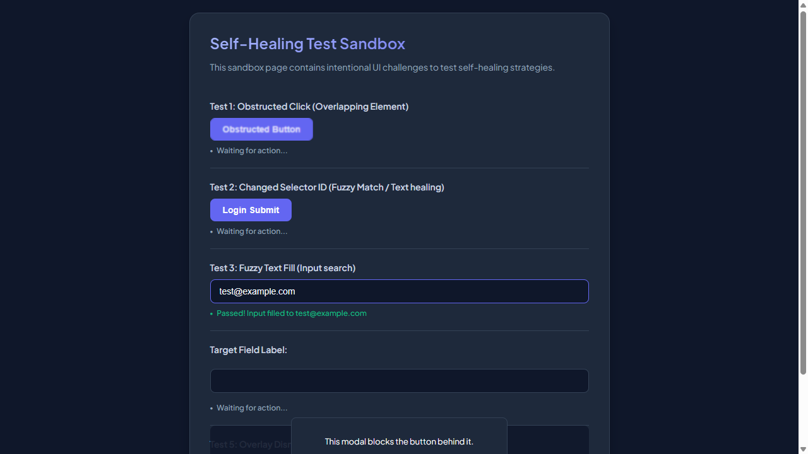
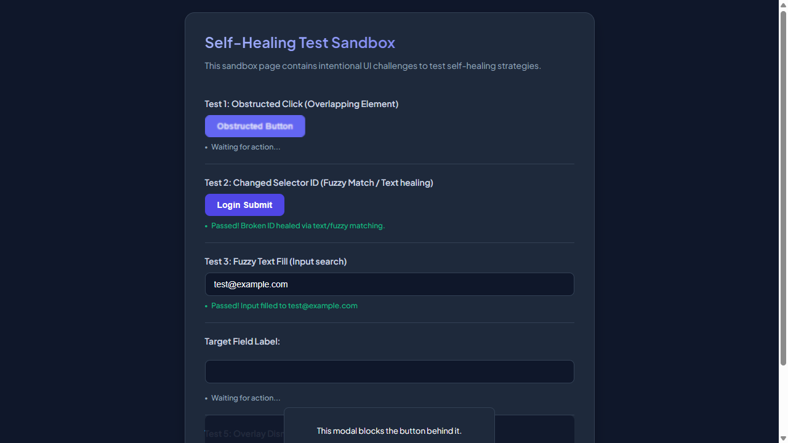

# 📑 WEBSITE BUSINESS SPECIFICATION & FUNCTIONAL INVENTORY
  
This document was automatically generated during an AI-powered business functional crawl.

- **Target Website**: [http://localhost:3009/test-self-healing.html](http://localhost:3009/test-self-healing.html)
- **Crawl Mode**: `Business Auto-Doc Mode (High-Level Summary)`
- **Crawl Date/Time**: 29/05/2026, 00:11:11
- **AI Explorer Model**: `qwen2.5-coder:7b` (Ollama)
- **Browser Executed**: `Chrome (Headless)`

---

## 🗺️ Section 1: Site Sitemap
Below is the list of unique page routes mapped by the AI crawler.

| No. | Page Title | Visited URL Pathname | Heading Hierarchy Detected |
| --- | --- | --- | --- |
| 1. | **Self-Healing Test Sandbox** | `/test-self-healing.html` | H1: "Self-Healing Test Sandbox" |

---

## 🔍 Section 2: Business Feature Catalog (Functional Inventory)
A comprehensive catalog of major UI elements, components, and sections discovered on each page, written in plain business English.

| Page Name | Feature/Component | Functional Description | Business / User Value |
| --- | --- | --- | --- |
| **/test-self-healing.html** | User Email Input Field | Allows users to enter their email address for authentication. | Enables users to securely log in or sign up using their email. |
| **/test-self-healing.html** | Generic Text Input Field | A generic text input field for various user inputs. | Facilitates the collection of diverse textual information from users. |
| **/test-self-healing.html** | Username Input Field in Modal | Enables users to enter a username within a modal dialog. | Supports user registration or login processes by capturing essential information securely. |
| **/test-self-healing.html** | Obstructed Button | A button that appears to be disabled or hidden, preventing interaction. | May be used as a placeholder or in scenarios where action is temporarily not available. |
| **/test-self-healing.html** | Login Submit Button | Allows users to submit their login credentials for authentication. | Enables users to access protected content or features after successful verification. |
| **/test-self-healing.html** | Interactive Target Button | A button that can be interacted with, often leading to specific actions or destinations. | Provides an interactive element for users to perform actions like clicking, submitting forms, etc. |
| **/test-self-healing.html** | Modal Close Button | Allows users to close a modal dialog, returning to the previous screen. | Enhances user experience by providing a straightforward way to navigate back or out of dialogs. |

---

## 🛣️ Section 3: User Journey & Visual Walkthrough
A sequential timeline showing exactly how the AI traversed the site, with explanations and visual proofs.

### Browser Run: **CHROME**

#### Step 1: Navigate to http://localhost:3009/test-self-healing.html

**Functional Intent**: *"Initial page load"*

- **From Path**: `Start`
- **To Path**: `/test-self-healing.html`

**Visual Proof**:

---

#### Step 2: [R1] fill → #user-email-address

**Functional Intent**: *"Provide user email for login process"*

- **From Path**: `/test-self-healing.html`
- **To Path**: `/test-self-healing.html`

**Visual Proof**:

---

#### Step 3: [R1] click → #healed-login-submit

**Functional Intent**: *"Submit login form to proceed"*

- **From Path**: `/test-self-healing.html`
- **To Path**: `/test-self-healing.html`

**Visual Proof**:

---

