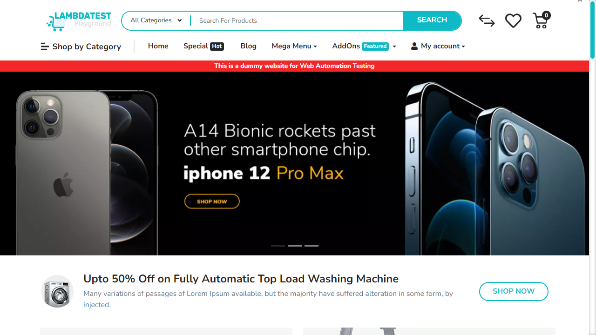
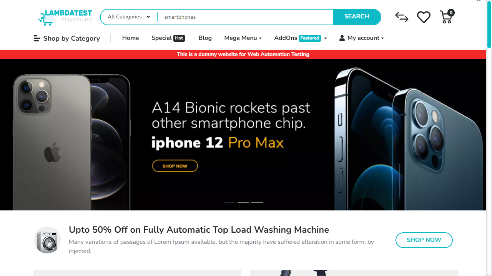
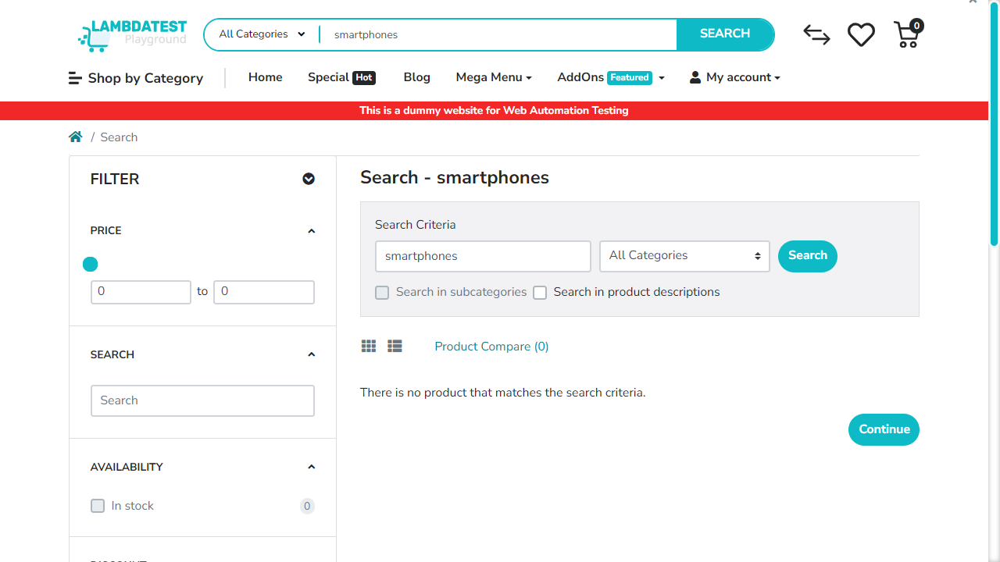
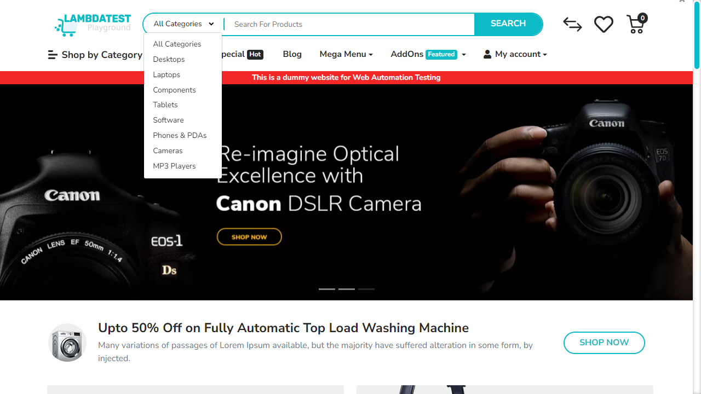

# 📑 WEBSITE BUSINESS SPECIFICATION & FUNCTIONAL INVENTORY
  
This document was automatically generated during an AI-powered business functional crawl.

- **Target Website**: [https://ecommerce-playground.lambdatest.io/](https://ecommerce-playground.lambdatest.io/)
- **Crawl Mode**: `Business Auto-Doc Mode (High-Level Summary)`
- **Crawl Date/Time**: 29/05/2026, 00:16:50
- **AI Explorer Model**: `qwen2.5-coder:7b` (Ollama)
- **Browser Executed**: `Chrome (Headless)`

---

## 🗺️ Section 1: Site Sitemap
Below is the list of unique page routes mapped by the AI crawler.

| No. | Page Title | Visited URL Pathname | Heading Hierarchy Detected |
| --- | --- | --- | --- |
| 1. | **Your Store** | `/` | H3: "Mobiles" H3: "Laptops" H3: "Accessories" H3: "Smart Wearable" H3: "Tablets" H3: "Computers" H3: "Sound System" H3: "Top Trending Categories" H3: "Top Products" H2: "Latest Range of Earphones" H3: "Top Collection" H3: "Under @99" H3: "From The Blog" |
| 2. | **Search - smartphones** | `/index.php` | H3: "Mobiles" H3: "Laptops" H3: "Accessories" H3: "Smart Wearable" H3: "Tablets" H3: "Computers" H3: "Sound System" H1: "Search - smartphones" H3: "Filter" |

---

## 🔍 Section 2: Business Feature Catalog (Functional Inventory)
A comprehensive catalog of major UI elements, components, and sections discovered on each page, written in plain business English.

| Page Name | Feature/Component | Functional Description | Business / User Value |
| --- | --- | --- | --- |
| **/** | Search Box | Allows users to enter keywords to search for products. | Improves user experience by enabling quick product discovery, potentially increasing sales. |
| **/** | Edit Cart Button | Opens a modal or page allowing users to modify their shopping cart contents. | Enables customers to make adjustments to their orders easily, reducing cart abandonment rates. |
| **/** | Previous Page Button | Navigates the user to the previous page in their browsing history. | Facilitates easy navigation and provides users with a sense of control over their browsing experience. |
| **/** | All Categories Button | Opens a menu or page listing all available product categories. | Assists customers in finding products by category, enhancing navigation and discoverability. |
| **/** | Search Button | Triggers the search functionality based on the user's input in the search box. | Enables users to initiate product searches efficiently, improving usability and accessibility. |
| **/** | Cart Summary Button | Displays the current cart summary, including item count and total price, and allows access to the cart. | Facilitates quick reference to the shopping cart, enhancing checkout readiness and convenience. |
| **/index.php** | mz_fp[min] | Allows user interaction with the number element. | Improves page engagement and usability. |
| **/index.php** | mz_fp[max] | Allows user interaction with the number element. | Improves page engagement and usability. |
| **/index.php** | mz_fq | Allows user interaction with the text element. | Improves page engagement and usability. |
| **/index.php** | mz_fss | Allows user interaction with the checkbox element. | Improves page engagement and usability. |
| **/index.php** | mz_fd | Allows user interaction with the radio element. | Improves page engagement and usability. |
| **/index.php** | mz_fd | Allows user interaction with the radio element. | Improves page engagement and usability. |
| **/index.php** | mz_fd | Allows user interaction with the radio element. | Improves page engagement and usability. |
| **/index.php** | mz_fd | Allows user interaction with the radio element. | Improves page engagement and usability. |
| **/index.php** | mz_fd | Allows user interaction with the radio element. | Improves page engagement and usability. |
| **/index.php** | mz_fr | Allows user interaction with the radio element. | Improves page engagement and usability. |
| **/index.php** | Edit cart | Allows user interaction with the button element. | Improves page engagement and usability. |
| **/index.php** | Interactive Element | Allows user interaction with the button element. | Improves page engagement and usability. |
| **/index.php** | All Categories | Allows user interaction with the button element. | Improves page engagement and usability. |
| **/index.php** | Search | Allows user interaction with the button element. | Improves page engagement and usability. |
| **/index.php** | 0   0 item(s) - $0.00 | Allows user interaction with the button element. | Improves page engagement and usability. |

---

## 🛣️ Section 3: User Journey & Visual Walkthrough
A sequential timeline showing exactly how the AI traversed the site, with explanations and visual proofs.

### Browser Run: **CHROME**

#### Step 1: Navigate to https://ecommerce-playground.lambdatest.io/

**Functional Intent**: *"Initial page load"*

- **From Path**: `Start`
- **To Path**: `/`

**Visual Proof**:

---

#### Step 2: [R1] navigate

**Functional Intent**: *"Load the main page to ensure all features are accessible"*

- **From Path**: `/`
- **To Path**: `/`

**Visual Proof**:

---

#### Step 3: [R1] click → [name='search']

**Functional Intent**: *"Initiate a search to explore product filtering capabilities"*

- **From Path**: `/`
- **To Path**: `/`

**Visual Proof**:

---

#### Step 4: [R1] fill → [name='search']

**Functional Intent**: *"Input search terms for smartphones"*

- **From Path**: `/`
- **To Path**: `/`

**Visual Proof**:

---

#### Step 5: [R1] click → button[type='submit']

**Functional Intent**: *"Submit the search query to display relevant results"*

- **From Path**: `/`
- **To Path**: `/index.php`

**Visual Proof**:

---

#### Step 6: [R1] scroll → .product-card

**Functional Intent**: *"Scroll through product cards to explore multiple options"*

- **From Path**: `/index.php`
- **To Path**: `/index.php`

**Visual Proof**:

---

#### Step 7: [R2] navigate

**Functional Intent**: *"Return to home page to explore other categories and features"*

- **From Path**: `/index.php`
- **To Path**: `/`

**Visual Proof**:

---

#### Step 8: [R3] click → button.btn

**Functional Intent**: *"Access all categories menu to explore products"*

- **From Path**: `/`
- **To Path**: `/`

**Visual Proof**:

---

