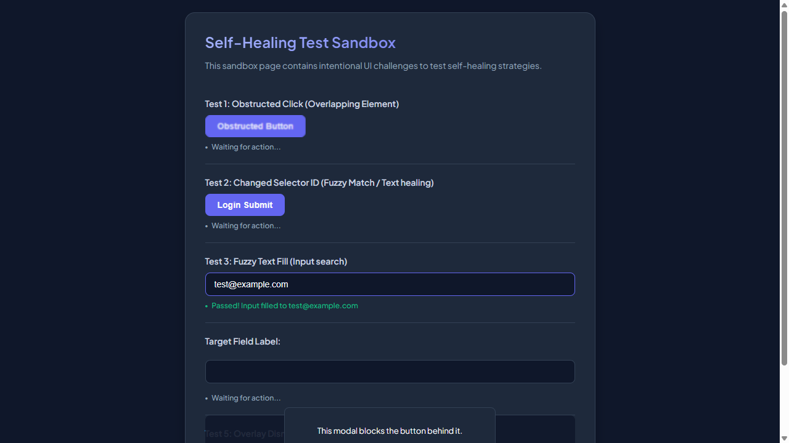
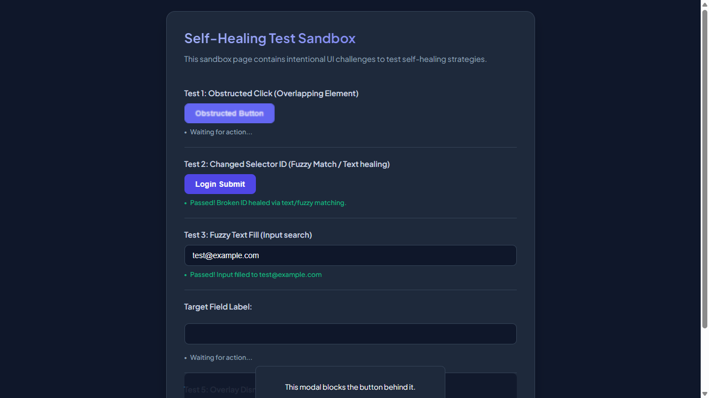

# 📑 WEBSITE BUSINESS SPECIFICATION & FUNCTIONAL INVENTORY
  
This document was automatically generated during an AI-powered business functional crawl.

- **Target Website**: [http://localhost:3009/test-self-healing.html](http://localhost:3009/test-self-healing.html)
- **Crawl Mode**: `Business Auto-Doc Mode (High-Level Summary)`
- **Crawl Date/Time**: 29/05/2026, 03:42:04
- **AI Explorer Model**: `qwen2.5-coder:7b` (Ollama)
- **Browser Executed**: `Chrome (Headless)`

---

## 🗺️ Section 1: Site Sitemap
Below is the list of unique page routes mapped by the AI crawler.

| No. | Page Title | Visited URL Pathname | Heading Hierarchy Detected |
| --- | --- | --- | --- |
| 1. | **Self-Healing Test Sandbox** | `/test-self-healing.html` | H1: "Self-Healing Test Sandbox" |

---

## 🔍 Section 2: Business Feature Catalog (Functional Inventory)
A comprehensive catalog of major UI elements, components, and sections discovered on each page, written in plain business English.

| Page Name | Feature/Component | Functional Description | Business / User Value |
| --- | --- | --- | --- |
| **/test-self-healing.html** | User Email Input Field | Allows users to enter their email address for authentication or registration. | Enables easy user identification and streamlines the login process. |
| **/test-self-healing.html** | General Text Input Field | A versatile text input field that users can use to enter various types of text information. | Enhances usability by providing a single input method for different data entry requirements. |
| **/test-self-healing.html** | Username Input in Modal | Prompts users to enter their username within a modal dialog, typically during user registration or login. | Increases security and privacy by requiring additional authentication steps before accessing sensitive information. |
| **/test-self-healing.html** | Obstructed Button | A button that appears to be disabled or hidden, potentially indicating a step in the process that requires further action. | Guides users through a multi-step process and ensures they complete necessary actions before proceeding. |
| **/test-self-healing.html** | Login Submit Button | Initiates the login process once the user has entered their credentials, completing the authentication step. | Enables users to access protected content or services securely and efficiently. |
| **/test-self-healing.html** | Interactive Target Button | An interactive button that triggers a specific action or feature when clicked, enhancing the user experience. | Increases engagement by providing immediate feedback and enabling users to perform desired actions with ease. |
| **/test-self-healing.html** | Close Modal Button | Allows users to close a modal dialog, typically used to exit forms or menus. | Provides a simple and intuitive way for users to navigate away from screens that are no longer relevant. |

---

## 🛣️ Section 3: User Journey & Visual Walkthrough
A sequential timeline showing exactly how the AI traversed the site, with explanations and visual proofs.

### Browser Run: **CHROME**

#### Step 1: Navigate to http://localhost:3009/test-self-healing.html

**Functional Intent**: *"Initial page load"*

- **From Path**: `Start`
- **To Path**: `/test-self-healing.html`

**Visual Proof**:

---

#### Step 2: [R1] screenshot

**Functional Intent**: *"Verify initial page layout and elements"*

- **From Path**: `/test-self-healing.html`
- **To Path**: `/test-self-healing.html`

**Visual Proof**:

---

#### Step 3: [R1] fill → #user-email-address

**Functional Intent**: *"Input user email for login process"*

- **From Path**: `/test-self-healing.html`
- **To Path**: `/test-self-healing.html`

**Visual Proof**:

---

#### Step 4: [R1] click → #healed-login-submit

**Functional Intent**: *"Initiate login process to access protected features"*

- **From Path**: `/test-self-healing.html`
- **To Path**: `/test-self-healing.html`

**Visual Proof**:

---

