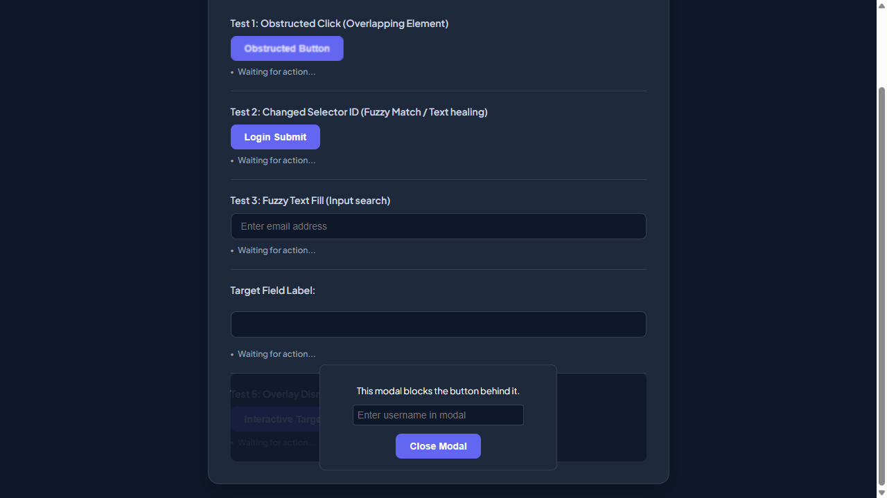
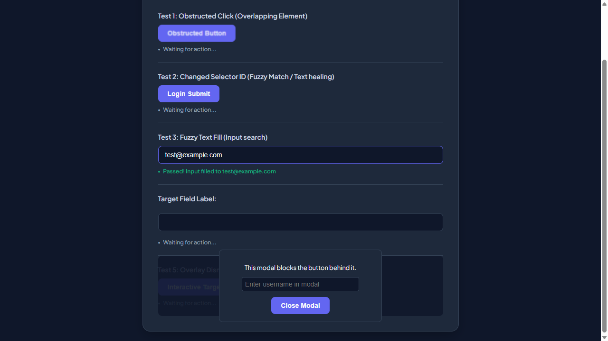
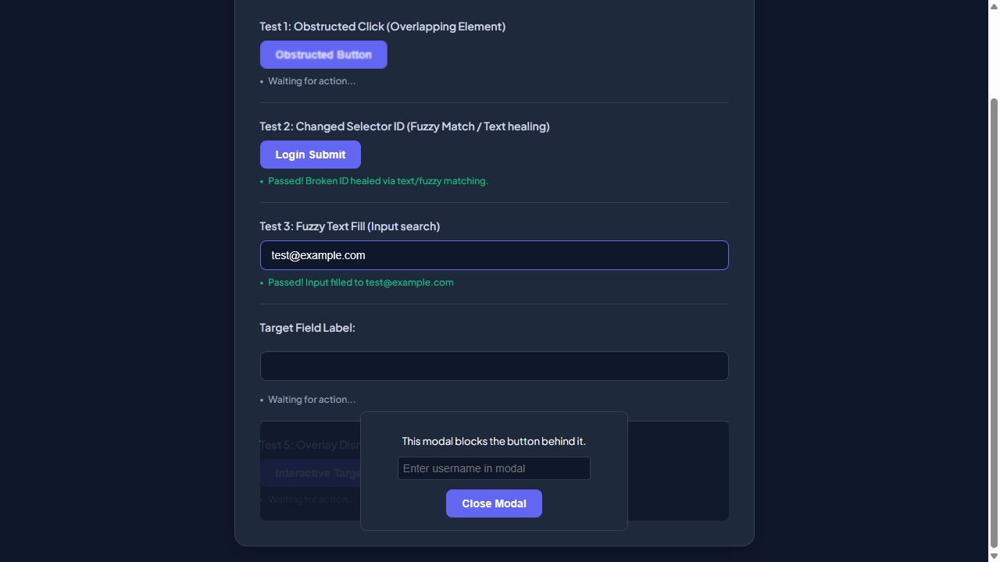
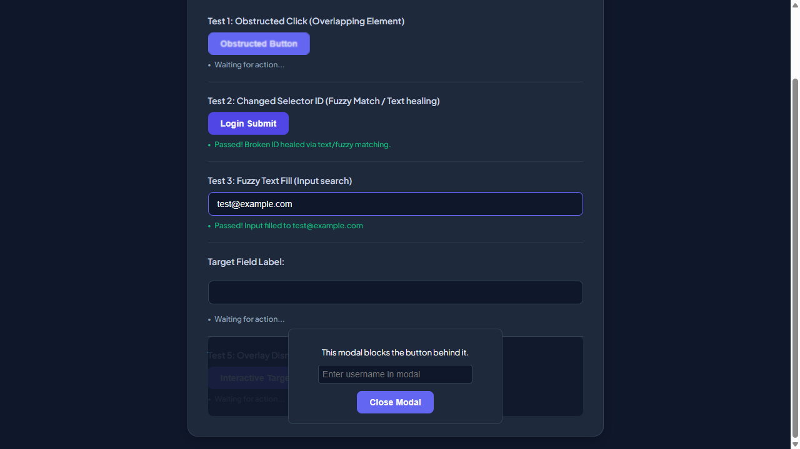
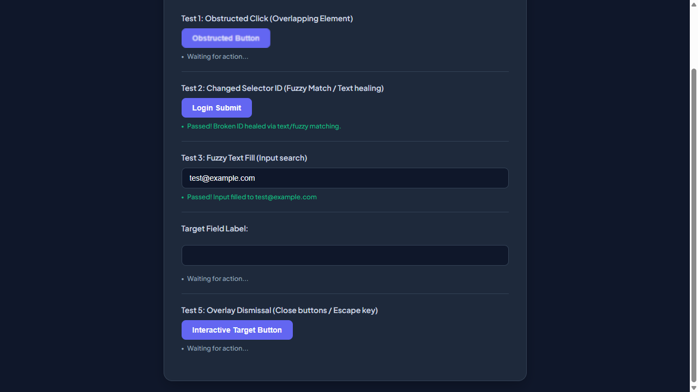
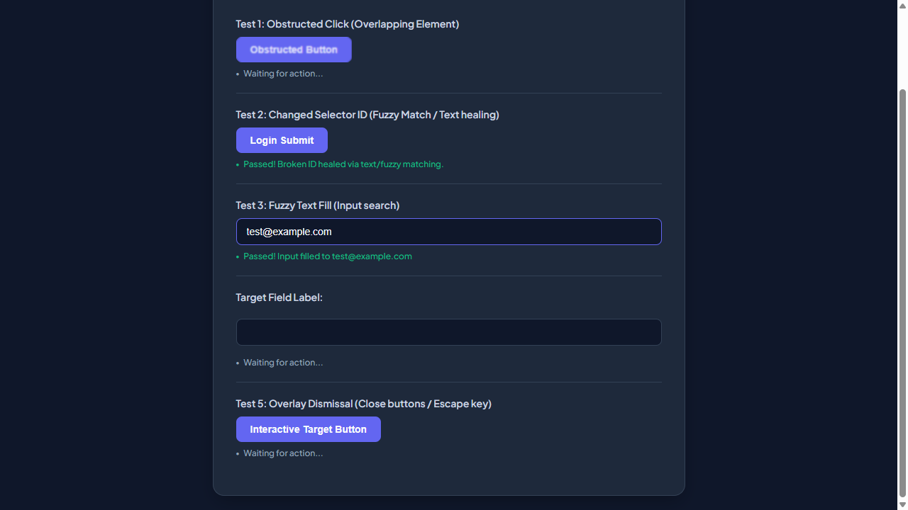
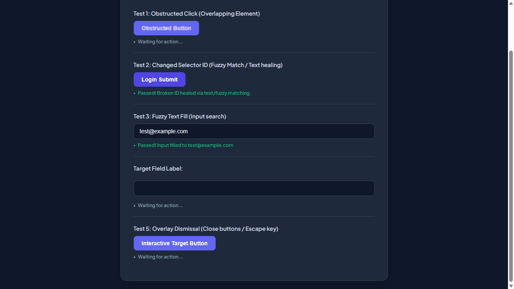
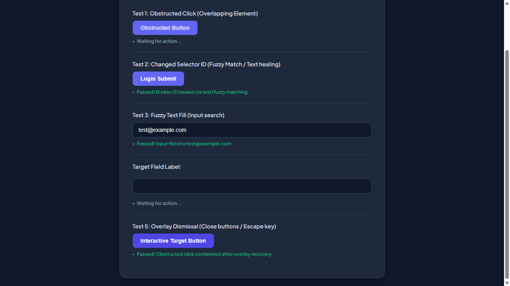

# 📑 WEBSITE BUSINESS SPECIFICATION & FUNCTIONAL INVENTORY
  
This document was automatically generated during an AI-powered business functional crawl.

- **Target Website**: [http://localhost:3009/test-self-healing.html](http://localhost:3009/test-self-healing.html)
- **Crawl Mode**: `Business Auto-Doc Mode (High-Level Summary)`
- **Crawl Date/Time**: 29/05/2026, 04:11:42
- **AI Explorer Model**: `qwen2.5-coder:7b` (Ollama)
- **Browser Executed**: `Chrome (Headless)`

---

## 🗺️ Section 1: Site Sitemap
Below is the list of unique page routes mapped by the AI crawler.

| No. | Page Title | Visited URL Pathname | Heading Hierarchy Detected |
| --- | --- | --- | --- |
| 1. | **Self-Healing Test Sandbox** | `/test-self-healing.html` | H1: "Self-Healing Test Sandbox" |

---

## 🔍 Section 2: Business Feature Catalog (Functional Inventory)
A comprehensive catalog of major UI elements, components, and sections discovered on each page, written in plain business English.

| Page Name | Feature/Component | Functional Description | Business / User Value |
| --- | --- | --- | --- |
| **/test-self-healing.html** | User Email Input Field | Allows users to enter their email address for login. | Enables customers to access their account using their email, enhancing convenience and user experience. |
| **/test-self-healing.html** | Username Input Field | Prompts users to enter a username in the modal. | Facilitates user registration or login by providing an easy way to identify and access accounts. |
| **/test-self-healing.html** | Modal Username Input | Collects a username from users in a modal window. | Secures user data and provides a dedicated space for entering sensitive information safely. |
| **/test-self-healing.html** | Obstructed Button | A button that is currently obstructed or inaccessible on the page. | Identifies potential issues with navigation or user interaction, affecting usability and user experience. |
| **/test-self-healing.html** | Login Submit Button | Enables users to submit their login credentials. | Streamlines the login process, allowing customers to access their accounts efficiently. |
| **/test-self-healing.html** | Interactive Target Button | An interactive button within a modal that performs an action when clicked. | Enhances user engagement and interaction by providing actionable elements within modals. |
| **/test-self-healing.html** | Modal Close Button | Allows users to close the modal window. | Provides a simple way for users to exit modals, maintaining a clean and organized user interface. |

---

## 🛣️ Section 3: User Journey & Visual Walkthrough
A sequential timeline showing exactly how the AI traversed the site, with explanations and visual proofs.

### Browser Run: **CHROME**

#### Step 1: Navigate to http://localhost:3009/test-self-healing.html

**Functional Intent**: *"Initial page load"*

- **From Path**: `Start`
- **To Path**: `/test-self-healing.html`

**Visual Proof**:

---

#### Step 2: [R1] screenshot

**Functional Intent**: *"Verify the initial state of the self-healing test sandbox"*

- **From Path**: `/test-self-healing.html`
- **To Path**: `/test-self-healing.html`

**Visual Proof**:

---

#### Step 3: [R1] click → #covered-btn

**Functional Intent**: *"Interact with the interactive target button to demonstrate self-healing functionality"*

- **From Path**: `/test-self-healing.html`
- **To Path**: `/test-self-healing.html`

**Visual Proof**:

---

#### Step 4: [R1] fill → #user-email-address

**Functional Intent**: *"Enter a user email address for further testing"*

- **From Path**: `/test-self-healing.html`
- **To Path**: `/test-self-healing.html`

**Visual Proof**:

---

#### Step 5: [R1] screenshot

**Functional Intent**: *"Verify the form input after entering an email address"*

- **From Path**: `/test-self-healing.html`
- **To Path**: `/test-self-healing.html`

**Visual Proof**:

---

#### Step 6: [R1] click → #healed-login-submit

**Functional Intent**: *"Submit the login form to test self-healing during submission"*

- **From Path**: `/test-self-healing.html`
- **To Path**: `/test-self-healing.html`

**Visual Proof**:

---

#### Step 7: [R2] click → #covered-btn

**Functional Intent**: *"Access interactive target button for further testing."*

- **From Path**: `/test-self-healing.html`
- **To Path**: `/test-self-healing.html`

**Visual Proof**:

---

#### Step 8: [R2] fill → #user-email-address

**Functional Intent**: *"Enter user email address for login purposes."*

- **From Path**: `/test-self-healing.html`
- **To Path**: `/test-self-healing.html`

**Visual Proof**:

---

#### Step 9: [R2] click → #healed-login-submit

**Functional Intent**: *"Submit the login form to authenticate the user."*

- **From Path**: `/test-self-healing.html`
- **To Path**: `/test-self-healing.html`

**Visual Proof**:

---

#### Step 10: [R3] fill → #user-email-address

**Functional Intent**: *"Provide user email for login process"*

- **From Path**: `/test-self-healing.html`
- **To Path**: `/test-self-healing.html`

**Visual Proof**:

---

#### Step 11: [R3] click → #healed-login-submit

**Functional Intent**: *"Submit login form to proceed with authentication"*

- **From Path**: `/test-self-healing.html`
- **To Path**: `/test-self-healing.html`

**Visual Proof**:

---

#### Step 12: [R4] screenshot

**Functional Intent**: *"Verify main page layout and UI elements"*

- **From Path**: `/test-self-healing.html`
- **To Path**: `/test-self-healing.html`

**Visual Proof**:

---

#### Step 13: [R4] click → button.modal-close-button

**Functional Intent**: *"Close any modal that might be open to ensure clean state"*

- **From Path**: `/test-self-healing.html`
- **To Path**: `/test-self-healing.html`

**Visual Proof**:

---

#### Step 14: [R5] click → button.modal-close-button

**Functional Intent**: *"Close any existing modal to ensure clean state"*

- **From Path**: `/test-self-healing.html`
- **To Path**: `/test-self-healing.html`

**Visual Proof**:

---

#### Step 15: [R5] fill → #user-email-address

**Functional Intent**: *"Enter test user email for login"*

- **From Path**: `/test-self-healing.html`
- **To Path**: `/test-self-healing.html`

**Visual Proof**:

---

#### Step 16: [R5] click → #healed-login-submit

**Functional Intent**: *"Submit the login form with provided credentials"*

- **From Path**: `/test-self-healing.html`
- **To Path**: `/test-self-healing.html`

**Visual Proof**:

---

#### Step 17: [R5] wait

**Functional Intent**: *"Wait for page to fully load after submission"*

- **From Path**: `/test-self-healing.html`
- **To Path**: `/test-self-healing.html`

**Visual Proof**:

---

#### Step 18: [R5] screenshot

**Functional Intent**: *"Capture post-login state of the application"*

- **From Path**: `/test-self-healing.html`
- **To Path**: `/test-self-healing.html`

**Visual Proof**:

---

#### Step 19: [R6] screenshot

**Functional Intent**: *"Verify the layout and visibility of self-healing elements"*

- **From Path**: `/test-self-healing.html`
- **To Path**: `/test-self-healing.html`

**Visual Proof**:

---

#### Step 20: [R6] click → #covered-btn

**Functional Intent**: *"Initiate interactive session to assess self-healing functionality"*

- **From Path**: `/test-self-healing.html`
- **To Path**: `/test-self-healing.html`

**Visual Proof**:

---

