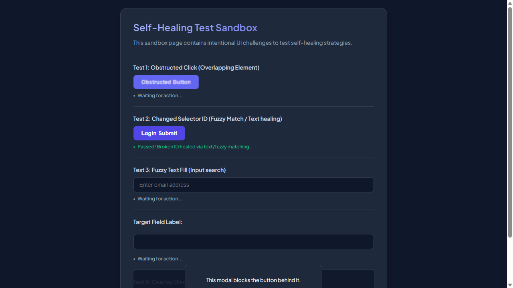
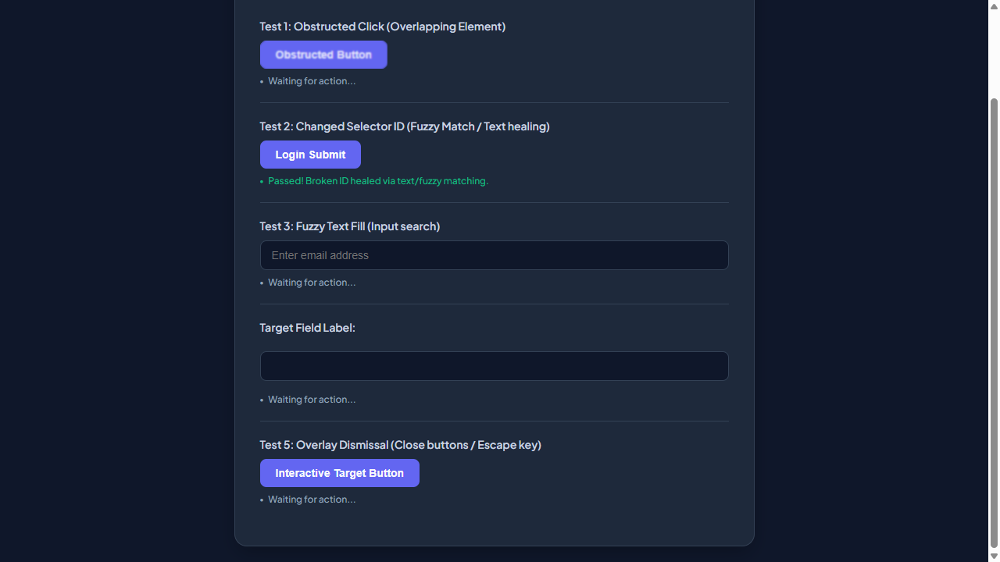
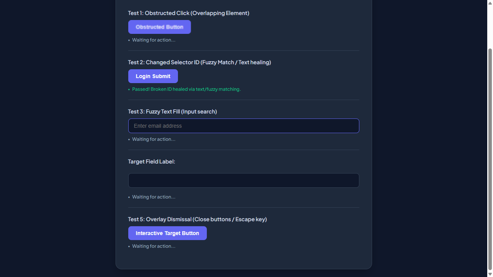
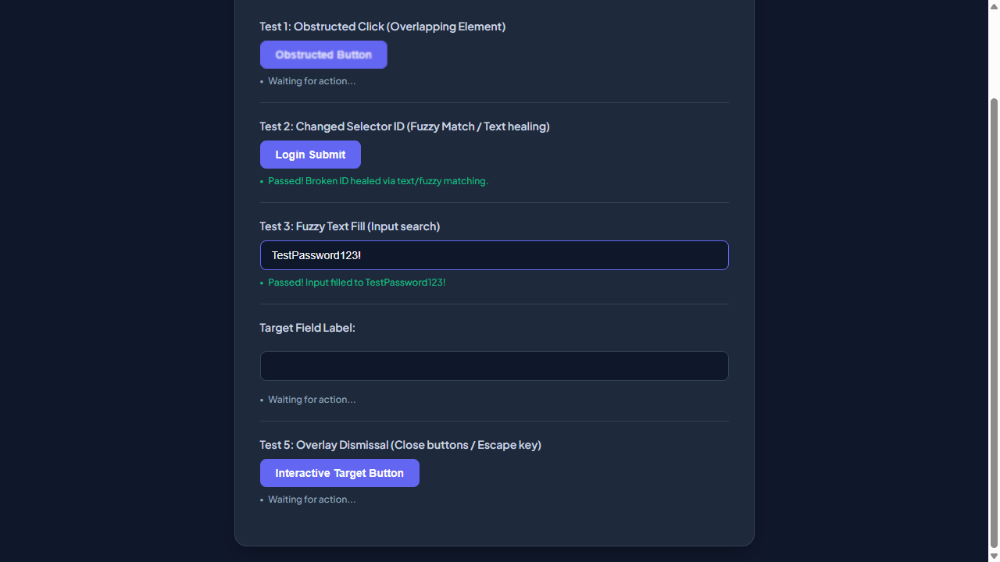
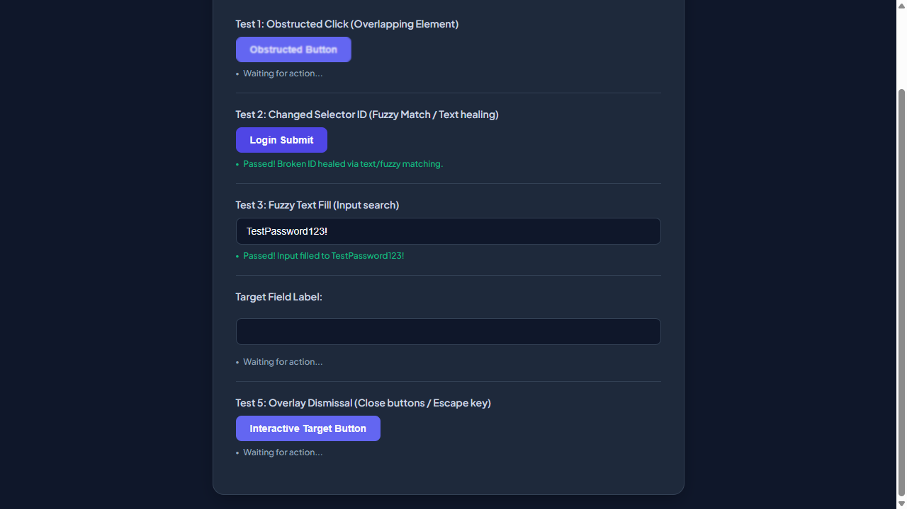

# 📑 WEBSITE BUSINESS SPECIFICATION & FUNCTIONAL INVENTORY
  
This document was automatically generated during an AI-powered business functional crawl.

- **Target Website**: [http://localhost:3009/test-self-healing.html](http://localhost:3009/test-self-healing.html)
- **Crawl Mode**: `Business Auto-Doc Mode (High-Level Summary)`
- **Crawl Date/Time**: 31/05/2026, 16:40:46
- **AI Explorer Model**: `qwen2.5-coder:7b` (Ollama)
- **Browser Executed**: `Chrome (Headless)`

---

## 🗺️ Section 1: Site Sitemap
Below is the list of unique page routes mapped by the AI crawler.

| No. | Page Title | Visited URL Pathname | Heading Hierarchy Detected |
| --- | --- | --- | --- |
| 1. | **Self-Healing Test Sandbox** | `/test-self-healing.html` | H1: "Self-Healing Test Sandbox" |

---

## 🔍 Section 2: Business Feature Catalog (Functional Inventory)
A comprehensive catalog of major UI elements, components, and sections discovered on each page, written in plain business English.

| Page Name | Feature/Component | Functional Description | Business / User Value |
| --- | --- | --- | --- |
| **/test-self-healing.html** | User Email Input Field | Allows users to enter their email address for authentication purposes. | Enables seamless user registration and login, enhancing customer convenience. |
| **/test-self-healing.html** | General Text Input Field | Provides a text input field for users to enter various types of information. | Supports flexible data collection, aiding in user surveys and feedback. |
| **/test-self-healing.html** | Username Input in Modal | Enables users to enter their username within a modal dialog for secure login. | Enhances security by isolating sensitive input, protecting user data. |
| **/test-self-healing.html** | Obstructed Button | A button that may be partially obstructed or have other elements covering it. | Needs to be investigated for usability issues, ensuring all buttons are accessible. |
| **/test-self-healing.html** | Login Submit Button | Allows users to submit their login credentials for authentication. | Enables quick and secure access to the platform, improving user experience. |
| **/test-self-healing.html** | Interactive Target Button | A button that may be covered or obstructed by other elements on the page. | Needs to be investigated for usability issues, ensuring all buttons are accessible. |
| **/test-self-healing.html** | Close Modal Button | Enables users to close a modal dialog or form window. | Improves user experience by providing an easy way to exit forms or dialogs. |

---

## 🛣️ Section 3: User Journey & Visual Walkthrough
A sequential timeline showing exactly how the AI traversed the site, with explanations and visual proofs.

### Browser Run: **CHROME**

#### Step 1: Navigate to http://localhost:3009/test-self-healing.html

**Functional Intent**: *"Initial page load"*

- **From Path**: `Start`
- **To Path**: `/test-self-healing.html`

**Visual Proof**:

---

#### Step 2: [R1] click → #healed-login-submit

**Functional Intent**: *"Initiate user login process to test system recovery"*

- **From Path**: `/test-self-healing.html`
- **To Path**: `/test-self-healing.html`

**Visual Proof**:

---

#### Step 3: [R1] screenshot

**Functional Intent**: *"Capture login form after successful submission to verify state"*

- **From Path**: `/test-self-healing.html`
- **To Path**: `/test-self-healing.html`

**Visual Proof**:

---

#### Step 4: [R1] scroll → body

**Functional Intent**: *"Scroll down to test infinite scroll functionality"*

- **From Path**: `/test-self-healing.html`
- **To Path**: `/test-self-healing.html`

**Visual Proof**:

---

#### Step 5: [R1] click → .modal-close-button

**Functional Intent**: *"Close modal to ensure it can be reopened and closed repeatedly"*

- **From Path**: `/test-self-healing.html`
- **To Path**: `/test-self-healing.html`

**Visual Proof**:

---

#### Step 6: [R2] click → #user-email-address

**Functional Intent**: *"Enter user's email address for login process"*

- **From Path**: `/test-self-healing.html`
- **To Path**: `/test-self-healing.html`

**Visual Proof**:

---

#### Step 7: [R2] fill → input[type="text"]

**Functional Intent**: *"Enter user's password for login process"*

- **From Path**: `/test-self-healing.html`
- **To Path**: `/test-self-healing.html`

**Visual Proof**:

---

#### Step 8: [R2] click → #healed-login-submit

**Functional Intent**: *"Submit the login form to authenticate user"*

- **From Path**: `/test-self-healing.html`
- **To Path**: `/test-self-healing.html`

**Visual Proof**:

---

